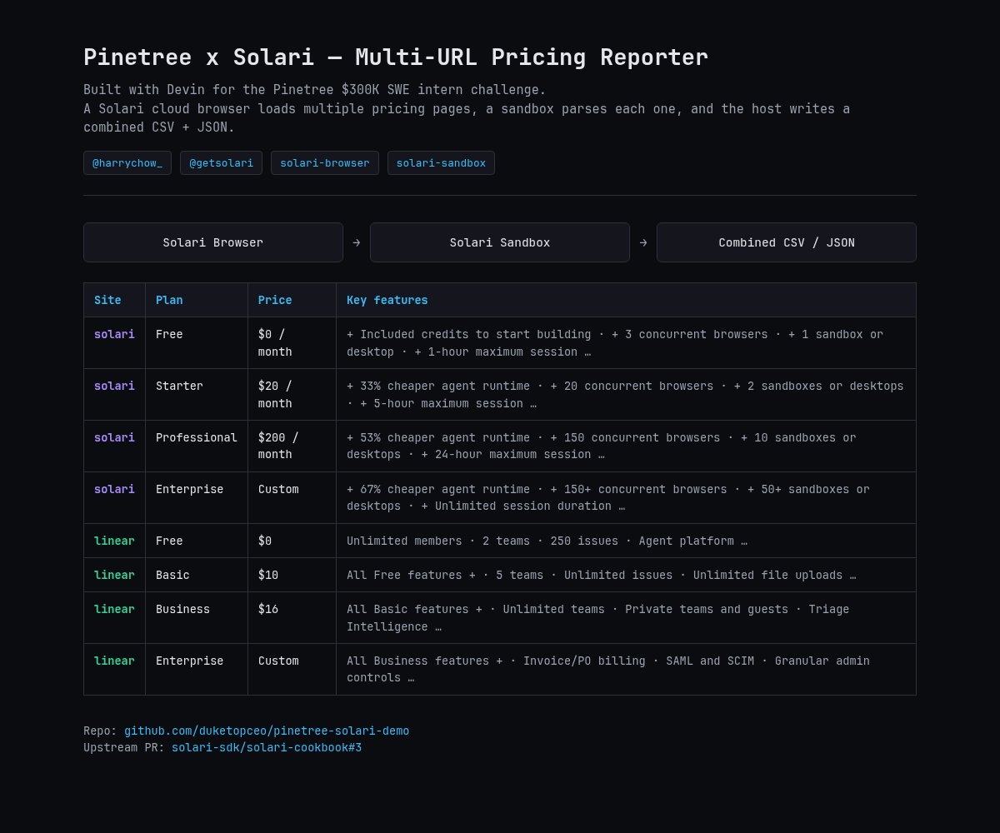
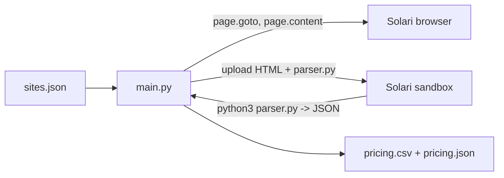

<p align="center"></p>

Collects SaaS pricing pages in a Solari cloud browser, parses them in a Solari sandbox, and writes one combined `pricing.csv` and `pricing.json`.

Built as a demo for the Pinetree Research SWE intern application. It is an example pipeline, not a production monitor. (Logo is a proposal, see `assets/brand/`.)



## How it works



1. `main.py` reads `sites.json` and opens one Solari browser session and one sandbox.
2. For each site it loads the URL, waits for `networkidle`, and uploads the HTML to the sandbox.
3. `parser.py` runs there (standard library `html.parser` only) in one of two modes: `card` (CSS class selectors) or `heading` (`h2`/`h3` + price + list-item heuristic).
4. The host downloads each site's JSON and merges all plans into `pricing.csv` (features joined with ` | `) and `pricing.json` (features as arrays).
5. A failing site is logged to stderr and skipped; the browser and sandbox are always closed at the end.

Captured output from a verified run on the Solari Free plan (Solari and Linear, 4 plans each) is in [`OUTPUTS.md`](OUTPUTS.md), with the sample `pricing.csv` / `pricing.json` in this repo.

## Install

Python 3.11+.

```bash
git clone https://github.com/duketopceo/pinetree-solari-demo
cd pinetree-solari-demo
pip install -r requirements.txt   # solari-browser, solari-sandbox
cp .env.example .env              # set SOLARI_API_KEY
```

## Run

```bash
python main.py
```

Optional environment variables read by the code: `SOLARI_BASE_URL`, `SITES_FILE` (default `sites.json`), `OUTPUT_CSV` (default `pricing.csv`), `OUTPUT_JSON` (default `pricing.json`).

## Configure sites

`sites.json` is a list. Each entry has `site`, `url`, and `mode`:

- `"mode": "card"` with `card_class`, `name_class`, `price_class`, `suffix_class`, `description_class`, `features_class`.
- `"mode": "heading"` with `heading_tags` (default `h2,h3`).

## Tests

No API key needed:

```bash
python -m unittest discover -s tests -v
```

CI runs the same command on push to `main` and on pull requests.

## Status and roadmap

Demo, in development; not deployed. See [`ROADMAP.md`](ROADMAP.md), [`DESIGN.md`](DESIGN.md) and [`docs/research/2026-10-10-landscape.md`](docs/research/2026-10-10-landscape.md). Known quirk: feature text currently keeps a leading `+ ` from the source pages.

The simpler single-site example was proposed to the Solari cookbook: https://github.com/solari-sdk/solari-cookbook/pull/3

## Contributing

Issues and PRs welcome; keep changes small and run the tests first. Do not commit `.env` or API keys.

## License

MIT
